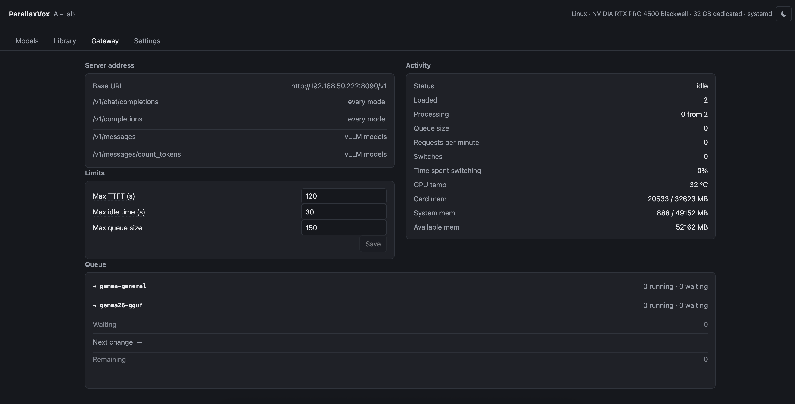

# The Gateway — one address for every model

The part an agent talks to, and the part nobody can guess: which model is
loaded, which comes off to make room, and when. If you read one document
here, read this one.

Each configured model is a separate engine on its own port. Pointed straight at
those, a client naming a model that happens not to be running gets a refused
connection. The Gateway is one address in front of all of them. It exposes the
OpenAI text and audio shapes supported by the configured engines, the
Anthropic Messages shape where the engine supports it, and this project's own
shapes for music, speech, alignment, OCR and images:

```sh
curl http://localhost:8090/v1/chat/completions \
  -H 'Content-Type: application/json' \
  -d '{"model": "reviewer", "messages": [{"role": "user", "content": "hello"}]}'
```

Replace `localhost` with the machine's address when calling from elsewhere;
8090 is the manager's default port.

Name any configured model by its id — the id only, not its label or file name.
No API key is checked; any value will do.
`GET /v1/models` lists every configured entry, loaded or not, which is the
point: a client is meant to be able to ask for one of them. Each entry also
says what it can do (its task, and whether it reads pictures or calls tools);
`GET /v1/models/{id}` gives one model in full. See
[Finding out what a model can do](requests.md#finding-out-what-a-model-can-do-before-using-it).

The **Server address** block is the contract of this particular installation.
It lists the endpoints available now and which configured models can answer
each one. Depending on what is configured, that includes chat and completion
requests, Anthropic messages and token counting, transcription, alignment
(matching a transcript to the audio word by word), voice-activity detection,
speaker diarization, OCR, image generation and editing, speech and music.
The list is built from the configured models' engines, so an endpoint
absent from this block has no model here that answers it. How to write each
request is in [Writing a request](requests.md).

### Long texts: counting before sending, and what a refusal says

A text model accepts at most `context_size` tokens in one request, prompt and
answer together (`GET /v1/models/{id}` gives it under `params`). That is a
limit **per request**. The cache behind it is one pool shared by every request
in flight: when the pool is full, vLLM makes the extra requests wait instead of
refusing them. So a refusal for length means that one text is too long, and
sending fewer requests at once does not help.

Measured on 20 October 2026, `qwen38-nvfp4` was started with a 0.93 share of
the card and a `context_size` of 98,304. With these settings the pool held
107,985 tokens, and bge-m3 still had room on the card. The 32,768 it had before
refused long Chinese articles. Chinese text needs many more tokens per
character than English.

**Counting first.** `POST /tokenize` counts a text's tokens for one model,
exactly as that model will count them. It is answered by vLLM models. Send the
same `messages` you are about to send, so that the chat template's own tokens
are counted too:

```sh
curl http://localhost:8090/tokenize -H 'Content-Type: application/json' \
  -d '{"model": "qwen38-nvfp4", "messages": [{"role": "user", "content": "..."}]}'
```

The answer carries `count` (the tokens) and `max_model_len` (the limit). A
client cuts a text when `count` plus the `max_tokens` it will ask for is
larger than the limit.

Counting is not a model call (since 22 October 2026). The engine's tokenizer
counts on the processor, so `/tokenize` takes no place on the card, waits in
no queue, and never loads a model. A model that is not
on the card cannot count; the answer is then **409** with:

```json
{"error": "qwen36-nvfp4 is not loaded, so it cannot count tokens now; loaded: qwen38-nvfp4",
 "ai_lab": {"reason": "model_not_loaded", "model": "qwen36-nvfp4", "loaded": ["qwen38-nvfp4"]}}
```

`error` is a sentence here, not the OpenAI-style object the `/v1/` paths
answer with, because `/tokenize` is not an OpenAI path; read `ai_lab.reason`.
A client that gets it either sends its first real request without counting
(that request loads the model through the queue) and counts from then on, or
waits until the model is loaded.

**What a refusal says.** When a text is too long anyway, the engine's 400 comes
back with its own message unchanged, and with the numbers under `ai_lab`:

```json
{"error": {"message": "This model's maximum context length is 98304 tokens. ..."},
 "ai_lab": {"reason": "context_too_long", "context_size": 98304,
            "prompt_tokens": 120000, "max_output_tokens": 1000}}
```

`prompt_tokens` is missing when vLLM refused on the text's length in characters
before counting it. In that case the refusal has `prompt_characters` instead.

**How full the pool is.** For a vLLM model on the card, `GET /v1/models/{id}`
also carries `live`, read from the engine at that moment:

```json
"live": {"kv_cache_tokens": 130389, "kv_cache_used": 0.62,
         "requests_running": 14, "requests_waiting": 0}
```

`kv_cache_tokens` is the shared pool's size. It changes with every reload, so
it is read live rather than configured. `kv_cache_used` is the share in use,
between 0 and 1. A model that is not loaded has no `live`.

A client sending many long requests can keep the tokens it has in flight
under about 80 % of the pool. Measured on 20 October 2026, `qwen38-nvfp4` held
16 places and a pool of 130,389 tokens. When clusters of long Chinese batches
filled 92–98 % of the pool, vLLM ran only 4–5 requests and parked 10–12. The
parked ones kept their 120 s running, and two of them timed out with 504.
Since 22 October 2026 a parked request is no longer cut for waiting; only an
engine that does no work at all is (see
[Gateway behavior](gateway-behavior.md#an-engine-that-reports-its-progress-vllm)).
Keeping under the pool still matters: a parked request waits, and the work is
done no sooner.

`live` also carries `tokens_processed`, every token vLLM has processed since it
started. The gateway reads it to tell a parked request from a stuck engine.

### OCR and image workflows

OCR is exposed at `POST /v1/images/ocr` and uses an isolated PaddleOCR 3.x
runtime. Image generation and editing are exposed at
`POST /v1/images/generations` and `POST /v1/images/edits`. Callers select an
operator-defined profile; arbitrary ComfyUI graphs are never accepted.
`GET /api/image-profiles` lists the profiles, with the task and model each one
uses. A request may carry only `profile`, `model`, `prompt`,
`negative_prompt`, `seed`, `width`, `height`, `steps`, `cfg_scale`, `n`
and `response_format`; any other field is refused.

Uploaded images — for OCR and for edits — are checked against the size limits
in the `gateway` section of the configuration: `max_upload_bytes`,
`max_upload_pixels` and `max_upload_dimension`. Zero means no limit.

An image call is an ordinary call (since 2026-10-25 there are no image jobs):
it waits in the card's queue like any other, and is answered with the images
once they are made. Its first-byte limit is
`gateway.task_timeouts.image-generation` or `image-edit`. Nothing about the
request or its images is kept on disk.

ComfyUI runs behind a private adapter and is deliberately single-concurrency:
its interrupt endpoint affects the current global execution. Workflow files
must be exported in API format and stored below `images.workflow_root`.

Music and speech are ordinary calls too: `POST /v1/audio/music/generations`
and `POST /v1/audio/speech/generations`.

### Models that never touch the card

Two kinds of model are served through the same address but never take a
place on the card, never wait behind a model being loaded and never hold one
up. Each has a queue of its own, and both appear in `GET /v1/models` beside
the card's models:

| Kind | Names | Path | Where it runs | Queue |
|---|---|---|---|---|
| Subscription models | `claude/sonnet`, `claude/opus`, `claude/haiku`, … (configured under `providers`) | `POST /v1/chat/completions` | the vendor's CLI (Claude Code, Codex, opencode), in the manager's machine, answered by the vendor | one per vendor: 6 calls at once by default, a shared pause after a rate limit |
| Processor models | `bge-m3` (configured under `cpu_models`) | `POST /v1/embeddings` | `llama-server --embedding` on the processor, from RAM; the card is hidden from it | one per model: 4 requests at once by default |

A subscription model answers text only, without streaming. A request that
names no `reasoning_effort` runs at the vendor's `default_effort`; an effort
the CLI does not know is refused. A JSON answer wrapped in a Markdown fence
comes back plain. A spent allowance answers 429, a CLI that cannot answer
502. Why and how: [ADR 0001](decisions/0001-subscription-providers.md),
[ADR 0002](decisions/0002-opencode-provider.md).

A subscription model may carry its limits in the configuration
(`context_size`, optionally `max_output_tokens`). The model list then shows
them as a local model's `ai_lab.params`, with the vendor's `concurrency` as
`max_sequences`, so the teams size their requests the same way. Example, the
Codex models on the Mac: `codex/gpt-5.6-sol` → `context_size` 258400 (Codex's
272,000-token window at its 95 % effective share).

A processor model is started by its first request (a second or two, longer
when its file is not cached) and stopped after `idle_stop_s` without use
(30 minutes by default). `POST /api/cpu-models/{name}/start` and `/stop` do
the same by hand. One text may have at most `context / parallel` tokens
(2,048 by default). Short texts are fastest sent many in one call, one call
at a time. Why and how, with measurements: [ADR 0003](decisions/0003-processor-models.md).

`GET /api/gateway` shows both: `providers` (per vendor: places, any pause,
today's requests and failures) and `cpu_models` (per model: running or not,
in flight, waiting, requests, failures, seconds idle). The interface shows
them on a page of their own, [Cloud & CPU](cloud-cpu.md), not on this one.
How to write the requests is in
[Writing a request](requests.md#models-that-never-touch-the-card).



The rest of the page is what is happening now, and every figure on it says what
it means when you hover it.

**Loaded** is how many models are on the machine; the queue below names them.
**Processing** is requests in flight against the places every loaded model
offers between them — places are the engine's own number and differ per model.
**Queued** is everything waiting its turn, whether for a place on a loaded
model or for one that has to be loaded first; the queue below says which is
which.

**Loads** counts models put on, **Evictions** counts models pushed off to make
room — the second is the one that hurts, because it costs the next request for
whatever was displaced. **Time spent switching** is the share of the working
time that went on loading rather than answering: the number that says a
workflow is thrashing.

**Available mem is given per pool and never added up.** A model has to fit in
one of them, so `12090 card · 40065 RAM` is two separate answers. Summed, it
would read as 52 GB of room on a machine with a 32 GB card and 48 GB of memory
— a place nothing can actually go.

The **Queue** is not a list of requests, it is what is about to happen. Each
loaded model with what it is answering and what is queued for it; **Waiting**,
the total queued for models already there; **Next change**, the model that has
to be loaded next; and **Remaining**, everything held up behind that change.

**Limits** are the numbers the page lets you change, and they take
effect at once, without a restart: **Max TTFT** (time to first token — how long
to wait for an engine to start answering, default 120 s), **Max idle time**
(how long a silence in the middle of an answer may last, default 30 s) and
**Max queue size** (how many requests may wait at once, default 150). The two
waits apply to engines that do not report their progress. For vLLM, which
does, **Max engine stall** (default 60 s) and **Max request time** (default
30 min) apply instead. **Default answer cap** (default 4,096 tokens) is added
to a text request that names no `max_tokens`. What each is for is in
[Gateway behavior](gateway-behavior.md#how-long-to-wait-for-an-engine).

### How loading and unloading is decided

**Nothing is loaded or unloaded on a timer, or in the background, or because
something looked idle.** Every change happens because a request needs it.

**A request goes straight through only if all three hold:** nobody is waiting,
the model it names is loaded, and that model has a free place. Otherwise it
joins the back of the queue — unless **Max queue size** requests are already
waiting, in which case it is refused at once with "try again shortly".

The first of those matters more than it looks. **The moment anybody is waiting,
the door closes for everybody** — including a request for a model that is
loaded and idle, which would cost nothing to serve. That is deliberate. Let
those past and the request at the head of the queue is never served, because
under a steady stream there is always another cheap one behind it. It is not
unlikely; it is certain.

**When a request finishes** and frees a place:

- the head of the queue wants a loaded model with room — it goes in, and again
  for as many as fit;
- the head wants something not loaded — nobody goes in. Room has to be made
  first;
- room can be made — the models chosen come off and the wanted one goes on.

**When the head of the queue wants a model that is not loaded**, how much room
it needs is worked out from the settings it asked for. If that fits in what is
free, it is simply loaded and **nothing comes off**. If it does not, models are
chosen to come off until it does:

1. **Idle models first**, longest-unused among them. Taking an idle model off
   costs no waiting.
2. **Then whichever answering model has gone longest without a request** — and
   everything stops until it has finished what it is doing. Cutting an answer
   short to make room is never done automatically; only the Unload button
   offers that, and it asks.

Because the door is shut while anybody waits, the models being drained cannot
pick up new work, so that wait is bounded by whatever was already in flight.

Two cases skip the arithmetic and **empty the machine of everything else**
(idle models first, then the answering ones, waited for as above):

- **The model needs 90% or more of the memory set aside for models.** In
  practice such a model needs an empty card; adding up the other models'
  estimates against an old reading can claim room that the card does not
  really have.
- **The engine cannot say how much it needs.** Some engines answer "unknown":
  voice-activity detection, llama.cpp told to split a model between card and
  system memory, and ComfyUI image models in a memory-saving mode. Unknown is
  treated as "may need all of it".

**Anything running that the Gateway has not taken up (see below) is also taken
off at the next switch**, because its memory is real but is not in the
arithmetic.

**A client that hangs up while waiting is dropped, not served.** This is
checked just before its turn, so a client that gave up never costs anybody a
model switch.

Nothing is protected from being unloaded. A model that is answering is waited
for, not spared.

**The run taken at a switch is the requests immediately behind the head that
want the same model, and no further.** The run stops at the first request
wanting something else, however many more of the first model are behind it.
Sweeping those up too would serve requests younger than one already waiting,
and the whole point of oldest-first is that a workflow may be held up by
exactly that older request. So the cost is visible rather than hidden: a
workflow alternating between two models that cannot both fit pays a load on
every step, and the fix is to reorder the workflow, not to change a setting
here.

**Requests arriving while a model loads wait for the next round**, even for the
model being loaded. Without that, the model just loaded starves the request
that was already waiting — the door problem again with the names swapped.

**How much a model needs is worked out each time and never remembered.** Each
engine answers for itself. For vLLM the answer is exact: it claims
`gpu_memory_fraction` of the whole card and the setting says which. For
llama.cpp the weights are taken as a floor and nothing more — measured at a
32k context, the gap between file size and card usage ran from **−476 MiB to
+6,663** across four models, so a computed cache figure would look precise and
be wrong. Engines that run as a separate worker with a fixed appetite — Higgs,
YuE2, HeartMuLa, MuLaCover, ComfyUI music — use a figure written per
model in the configuration, `memory_reservation_mb`. Qwen-TTS, VoxCPM and
Khala take their weights plus half again, and at least 2 GB more; the rest
mostly take their weights. What a model took last time is knowledge about the
past, and it belongs to whatever is making the requests.

**A model that will not fit however much comes off is refused before anything
is disturbed**, with the numbers to correct by — see
[When a model cannot be loaded](requests.md#when-a-model-cannot-be-loaded). Unloading what
was working to load something that was never going to fit is the worst of both.

**A model that is running but that the Gateway did not load** — started from
the Models page, or left over from a manager restart — is taken up as it is
rather than reloaded. If it is still coming up it is left for later and looked
at again, because sending requests to a port with nothing behind it is worse
than waiting.

Two consequences worth designing around:

- A model plus the settings it was started with is one thing. Two requests for
  the same model wanting different context sizes cannot both be served without
  a reload.
- **A request must not wait, inside itself, on another request to this
  gateway.** Fill every place with things that cannot finish and nothing
  finishes.

### What it costs, measured

Two llama.cpp models loaded together on the RTX PRO 4500:

| | on the card | answered in |
|---|---|---|
| `gemma-general` | 3,544 MB | 0.04 s |
| `gemma26-gguf` | 20,539 MB together | 0.08 s |

Alternating between those two used to cost a load every time — 3.1 s and 7.3 s.
Neither leaves now.

Requests to one loaded model run together, up to the number the engine was
started to serve. Measured with Qwen3-Coder-30B at eight places: eight requests
at once took 1.2 s against 3.1 s one after another.

The gateway itself costs **1 ms** over talking to the engine directly.

### What fits beside what, measured

Every model here was loaded on the RTX PRO 4500 (32,623 MiB) and the card read
afterwards:

| model | engine | on the card |
|---|---|---|
| `gemma-4-E4B` | llama.cpp | 3,902 MiB |
| `gemma-4-26B-A4B` | llama.cpp | 18,184 |
| `Qwen3.6-35B-A3B` | llama.cpp | 21,880 |
| `gemma-4-31B` | llama.cpp | 24,614 |
| `qwopus27b` | vLLM | 27,382 |
| `glm47flash` | vLLM | 28,350 |
| `gemma-4-26B-A4B` | vLLM | 28,842 |
| `coder30b` | vLLM | 29,740 |

**A vLLM model takes a share of the whole card, not what its weights need.**
`gpu_memory_fraction` is 0.9 by default, and gemma-4-26b has 17.5 GB of weights
and occupies 28.8 GB — the rest is cache for concurrent requests. So two vLLM
models at the default never fit together, and lowering the fraction is the only
thing that changes that.

**llama.cpp takes roughly its weights plus a cache.** How much cache is not
worth predicting: at a 32k context the gap between file size and card usage ran
from **−476 MiB to +6,663** across four models, because architectures differ in
how they attend. So when the weights alone will not fit, llama.cpp is told to
put on as many layers as it can and leave the rest in system memory — it
measures the card at startup, which nothing outside it can do. That is slower:
moving 20 of 80 layers off the card cut prompt reading to a ninth here.
Generation suffers far less.

---

[← all documents](../README.md)  ·  [Library](library.md)  ·  [Settings](settings.md)
