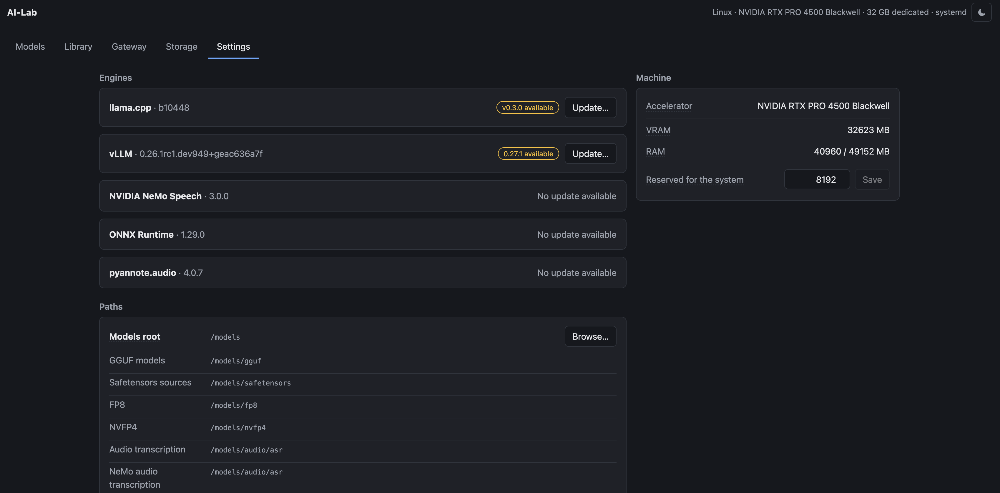

# Settings — the machine, its engines, and where models live

Nothing on this page moves on its own. What is used, how warm the card is, how
many requests are running are facts about right now, and right now is the
Gateway page — a figure read here is still true an hour later.



**Machine** is what this machine is, and the one thing that decides how many
models fit: how much of its memory is held back for the machine itself. A
dedicated card is used whole — nothing else here wants it. The machine's own
memory is shared with the browser and the operating system, so a reserve is
kept out of it. Set as a reserve rather than as an allowance, because a reserve
stays right when the machine is given more memory.

**Engines** shows what is installed, its version, and the state of its update
source. `No update available` means upstream was read and matches what is
installed; `Update status unavailable` means it could not yet be read;
`Updates not managed` means AI-Lab does not install that engine at all. When a
new version exists it is named beside the **Update…** button. No button here
updates anything directly: it opens what the update would bring, and the real
Update is at the foot of that. An engine that arrives as packages but is not
installed yet shows **Install…** instead, which works the same way. See
[Updating an engine](engines.md).

An engine that cannot run carries a short reason, such as `Requires an NVIDIA
GPU` or `Not installed`. An engine this kind of machine does not support at
all — vLLM on a Mac, say — is not listed. While an engine is being built its
output streams into a pane under it; afterwards that pane folds away as
**Last update log**. ComfyUI's add-ons (custom nodes, extra pieces ComfyUI
loads) are listed in a fold of their own, each with its version and, when
there is one, an update button. An add-on someone edited by hand is marked
`local changes` and is not updated over.

NeMo and ONNX audio adapters use isolated Python environments. They are shown
as installed capabilities and can be selected only for compatible tasks and
weight formats. Their environments are deliberately separate from the manager
and vLLM so a speech dependency cannot replace the CUDA stack used elsewhere.

**Engine paths** sits under Engines and names the program used to launch each
installed engine. A change takes effect the next time a model starts.
**Paths** sits under Machine. It holds the two model stores —
**Production models** (core) and **Temporary / benchmark models**, explained in
[Library](library.md#two-places-to-keep-models) — and, below them, the folder
derived from the production store for every text weight format and audio task.
A derived folder that is missing or read-only is marked so. Audio formats used by
different engines are grouped under transcription, voice activity detection
and speaker diarization; engine-specific submodels do not become separate
storage locations. The paths that are choices are picked from a listing of
what is actually on the machine rather than typed — a path typed by hand is a
path with a typo in it, and the failure arrives much later as a screen with no
models on it.

## Limits, upload caps and the card's monitor

How long this machine's slow jobs may take, and where its ports start. They
live in `config.json` under `limits` (read by `config/policy.py`,
`MachineLimits`) and are shown on this page as fields, grouped as *Loading
models*, *Engine updates*, *Embeddings lane* and *Client caps*; each says,
when pointed at, what it means, its default and what too small or too large
does. Beside them, *Uploaded images* holds the gateway's three upload caps
(`gateway.max_upload_*`, [the gateway](gateway.md)) and the four *GPU
health* sections every setting of the card's monitor but `channel`
([GPU health](gpu-health.md)). All but the first port take effect at the next
start of AI-Lab. Every value may be left out; then the default below holds,
which is what the code did before they became settings. A wrong value stops
AI-Lab at start with a message naming it.

```json
"limits": {
  "runtime":    {"start_s": 60, "load_s": 900, "unload_s": 120},
  "builds":     {"install_s": 3600, "build_s": 3600, "check_every_s": 3600,
                 "builds_first_check_s": 20, "installs_first_check_s": 25,
                 "system_path": "/usr/local/bin:/usr/bin:/bin"},
  "embeddings": {"start_s": 120, "stop_s": 30, "drain_s": 60, "hold_s": 900, "call_s": 600},
  "clients":    {"chars_per_token": 3.0, "retry_after_s": 5},
  "first_port": 8080,
  "editor_port_offset": 10000
}
```

| Value | What it limits | Default |
|---|---|---|
| `runtime.start_s` | A model's engine process to appear after it is started | 60 s |
| `runtime.load_s` | The engine to answer once started: weights read, a first compile. Raise it for a model that takes longer than 15 minutes to load | 900 s |
| `runtime.unload_s` | The process to exit when stopped, and again for its memory to come back | 120 s |
| `builds.install_s` | One install command of a package-installed engine or a git application (ComfyUI) | 3600 s |
| `builds.build_s` | One compile step of an engine built from source (llama.cpp) | 3600 s |
| `builds.check_every_s` | How often upstream is asked for new versions | 3600 s |
| `builds.builds_first_check_s`, `builds.installs_first_check_s` | The first ask after start, for source builds and for installs (apart, so the two do not ask at once) | 20 s, 25 s |
| `builds.system_path` | Where the programs a new environment is built with are found (absolute folders joined by `:`) | `/usr/local/bin:/usr/bin:/bin` |
| `embeddings.start_s` | An embeddings model's server to answer after it starts | 120 s |
| `embeddings.stop_s` | That server to exit when asked, before it is killed | 30 s |
| `embeddings.drain_s` | The embeddings calls on the card to finish when a card model needs the card | 60 s |
| `embeddings.hold_s` | How long the embeddings lane stays off the card if that card load never reports back | 900 s |
| `embeddings.call_s` | One embeddings call to its server (the queue wait not counted) | 600 s |
| `clients.chars_per_token` | A capped client's prompt is counted as its characters divided by this ([caps](access.md)) | 3.0 |
| `clients.retry_after_s` | How long a client over its cap is told to wait (`Retry-After`) | 5 s |
| `first_port` | The first port offered when a model entry is added | 8080 |
| `editor_port_offset` | How far above a model's port its own page listens (ComfyUI, the speech editors, the music studios); 1000 to 50000, read at start. On CT 102 the firewall opens only 18124 (YuE2 Studio); another offset needs home-lab to open the new port | 10000 |

The gateway's own waits (`first_byte_s`, `between_bytes_s`, `stall_s`,
`safety_s`, `max_waiting`, `default_max_tokens`, per-task waits) stay in the
`gateway` section: see [How long to wait for an engine](gateway-behavior.md).

---

[← all documents](../README.md)  ·  [Gateway](gateway.md)  ·  [Writing a request](requests.md)
